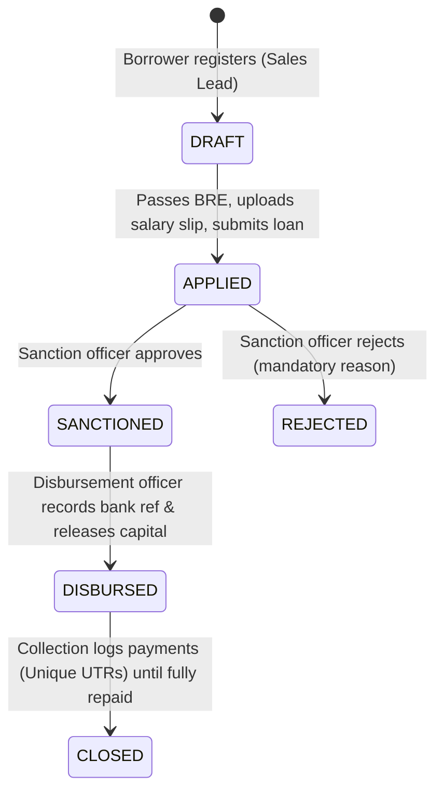

# 🏦 CreditSea — Loan Management System (LMS)

Enterprise-grade Loan Management System built for **CreditSea**, implementing an intuitive Borrower Application Portal and an Operations Dashboard across Sales, Sanction, Disbursement, and Collection modules with strict Role-Based Access Control (RBAC).

---

## 🎨 CreditSea Design System & Tech Stack

| Layer | Technology |
|---|---|
| **Branding** | CreditSea Corporate Identity (Vibrant Royal Blue `#0066FF`, crisp clean cards, modern fintech typography) |
| **Frontend** | Next.js 14+ (App Router), TypeScript, Tailwind CSS |
| **Backend** | Node.js, Express.js, TypeScript |
| **Database** | MongoDB with Mongoose ODM |
| **Security & Auth** | JWT (JSON Web Tokens), `bcrypt` password hashing, RBAC middleware |
| **Document Processing** | Multer disk storage (PDF/JPG/PNG up to 5 MB) |
| **Validation** | Zod schemas (compile-time & runtime verification) |

---

## ⚙️ Quick Start Guide

### Prerequisites
- Node.js 18+
- MongoDB running locally on `mongodb://localhost:27017` (or MongoDB Atlas URI)

### 1. Install Dependencies

```bash
# Backend dependencies
cd server && npm install

# Frontend dependencies
cd ../client && npm install
```

### 2. Environment Configuration

```bash
# Server (.env)
cp server/.env.example server/.env

# Client (.env.local)
cp client/.env.example client/.env.local
```

### 3. Seed Pre-Configured Test Accounts

Populate the database with pre-configured accounts for all roles:

```bash
cd server && npm run seed
```

### 4. Start Development Servers

```bash
# Terminal 1 — Express Backend (Port 5000)
cd server && npm run dev

# Terminal 2 — Next.js Frontend (Port 3000)
cd client && npm run dev
```

Open [http://localhost:3000](http://localhost:3000) in your browser.

---

## 📋 Evaluation Demo Credentials

All test accounts are seeded with password: **`password123`**  
*(The login page also provides 1-click quick-fill buttons for effortless evaluator testing)*

| Role | Email | Password | Access Rights |
|---|---|---|---|
| **Admin** | `admin@lms.com` | `password123` | Universal access to Overview, Sales, Sanction, Disbursement & Collection |
| **Sales** | `sales@lms.com` | `password123` | Pre-application lead pipeline tracking |
| **Sanction** | `sanction@lms.com` | `password123` | Underwriting queue, applicant review, Approve / Reject with reason |
| **Disbursement** | `disbursement@lms.com` | `password123` | Sanctioned loans, fund release with bank transaction references |
| **Collection** | `collection@lms.com` | `password123` | Repayment recording, unique UTR verification, auto-loan closure |
| **Borrower** | `borrower@lms.com` | `password123` | Multi-step loan application, BRE verification, live SI calculator |

---

## 🔄 End-to-End Loan Lifecycle Walkthrough



### 1. Borrower Journey
1. **Sign Up / Login**: Passwords hashed with `bcrypt`. JWT issued with `Borrower` role.
2. **Personal Details & Server-side BRE**:
   - Age rule: Must be between **23 and 50 years** (calculated from DOB).
   - Salary rule: Must be at least **₹25,000 / month**.
   - PAN regex: Indian standard `^[A-Z]{5}[0-9]{4}[A-Z]{1}$`.
   - Employment status: `Unemployed` rejected.
3. **Salary Slip Upload**: Handles PDF, JPG, PNG up to **5 MB** via Multer.
4. **Loan Configuration**: Dual sliders for Amount (₹50K–₹5L) and Tenure (30–365 days).
   - Live Simple Interest computation:
     $$\text{SI} = \frac{P \times 12 \times T}{365 \times 100}, \quad \text{Total Repayment} = P + \text{SI}$$
   - Submits loan with status **`APPLIED`**.

### 2. Operations Dashboard
- **Sales Module** (`/dashboard/sales`): Tracks drop-offs and unsubmitted borrowers.
- **Sanction Module** (`/dashboard/sanction`): Inspects borrower profile and salary slips; approves or rejects with mandatory reason.
- **Disbursement Module** (`/dashboard/disbursement`): Authorizes fund payout, logs transaction reference, and updates loan status to **`DISBURSED`**.
- **Collection Module** (`/dashboard/collection`): Logs borrower repayments with strictly unique UTRs; auto-closes loan to **`CLOSED`** once full repayment is received.
- **Admin Command Center** (`/dashboard`): Real-time KPI aggregate cards (Total Disbursed, Total Collected, Total Outstanding) and all module shortcuts.

---

## 🛡️ Security & Access Control

- **Two-Layer RBAC**: Enforced both on the client (`ProtectedRoute` route guards) and backend (`authorizeRoles` middleware returning `403 Forbidden`).
- **UTR Uniqueness**: Database-level unique index on `utrNumber` preventing duplicate payment records.
- **Input Sanitization**: Strictly validated using Zod schemas.

---

## 📁 Repository Structure

```
LMS_Assignment/
├── client/                     # Next.js 14+ Frontend (CreditSea Theme)
│   ├── src/
│   │   ├── app/                # App Router pages
│   │   │   ├── (auth)/         # Login & Register
│   │   │   ├── borrower/       # Borrower application portal
│   │   │   └── dashboard/      # Operations modules (Sales, Sanction, Disbursement, Collection)
│   │   ├── components/         # CreditSeaLogo, ProtectedRoute, DashboardShell
│   │   ├── context/            # AuthContext provider
│   │   └── lib/                # API client & shared TypeScript types
│   └── ...
├── server/                     # Express.js Backend API
│   ├── src/
│   │   ├── config/             # MongoDB connection
│   │   ├── controllers/        # Business logic controllers
│   │   ├── middleware/         # Auth, RBAC, and Multer upload
│   │   ├── models/             # User, BorrowerProfile, Loan, Repayment
│   │   ├── routes/             # REST API routes
│   │   ├── seeds/              # Database seed script
│   │   ├── services/           # BRE engine & Simple Interest calculator
│   │   └── validators/         # Zod request validators
│   └── uploads/                # Statically served document storage
└── README.md
```
